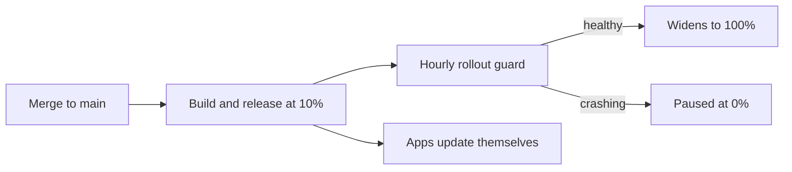

import { Card, CardGrid, LinkCard } from '@astrojs/starlight/components'

## What you get

<CardGrid>
  <Card title="Desktop app">
    Electron, Vite, React and TypeScript. A sandboxed window, a typed bridge to the main process,
    tray, settings and updates.
  </Card>
  <Card title="Website and web app">
    A marketing site, a download page that reads the latest release, and the web version of the app,
    all served from one Cloudflare Worker.
  </Card>
  <Card title="API and sign-in">
    Hono on Cloudflare Workers with D1. Sign in with a magic link or a passkey, teams, single
    sign-on and directory sync for companies.
  </Card>
  <Card title="Safe releases">
    Every merge to `main` builds for Windows, macOS and Linux, publishes at 10%, and widens or
    pauses on its own.
  </Card>
</CardGrid>

## How a change reaches people

## Where to go next

<LinkCard
  title="Set up the website and API"
  description="One command for the Cloudflare, Resend and GitHub accounts."
  href="./guides/setup-cloud/"
/>
<LinkCard
  title="Releasing"
  description="How a release goes out, how the rollout widens, and how to roll back."
  href="./releasing/overview/"
/>
<LinkCard
  title="Keeping an app up to date with the template"
  description="Pull the template's newer changes into an app made from it."
  href="./guides/template-updates/"
/>
<LinkCard
  title="API, database and sign-in"
  description="Routes, tables, sign-in methods, staff roles and the AI app (MCP) endpoint."
  href="./api/overview/"
/>
