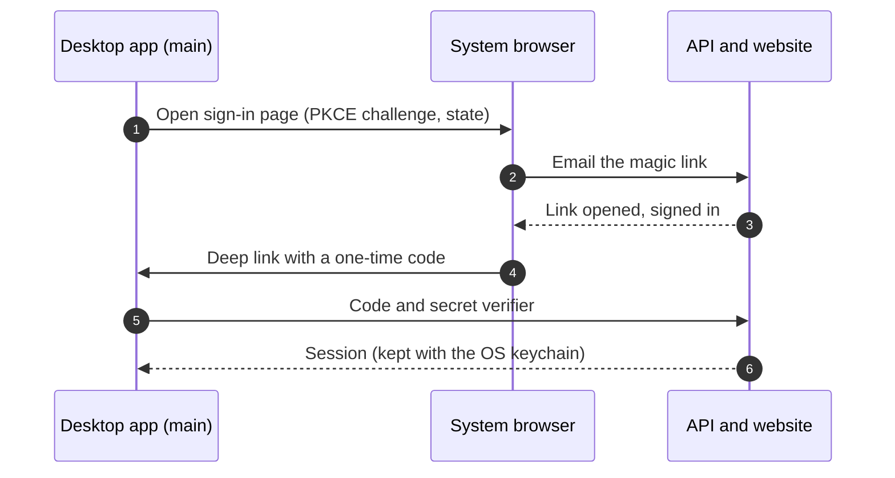

# Account sign-in in the app

How the desktop app signs a person in through their browser and back through a deep link. Back to the [architecture overview](./architecture.md).

## Account sign-in (browser, then back through the deep link)

Optional; only builds that know the API address (`API_URL`, baked in as `__API_URL__`) show it.

1. Settings > Account > **Sign in** calls `window.api.signIn()`, which reaches main (`src/main/auth.ts`) and `requestAuth()`. It opens the
   system browser on `<API>/sign-in` with a PKCE challenge and a random `state`. The sign-in page and its cookies never live inside Electron.
2. The person enters their email and opens the emailed magic link in the browser.
3. The site opens `<scheme>:/auth/callback#token=<one-time code>`. `deeplink.ts` routes it to `handleAuthCallback` in main, which first
   checks it with `authLink.ts` (scheme, path, characters and length of the code).
4. Main swaps the code and its secret verifier (which never left the process) for a session. The session is stored encrypted
   with the OS keychain (`safeStorage`). `account:changed` tells the windows.

The renderer only has `getAccount`, `signIn` and `signOut`; it never sees tokens. We use the client half of `@better-auth/electron`
only, not its `setupMain`, which would replace this app's scheme registration, CSP, single-instance lock and IPC.
