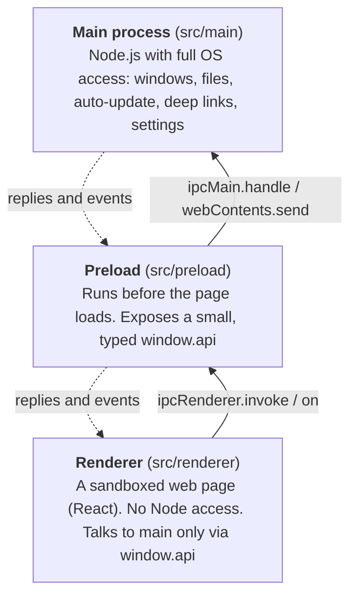
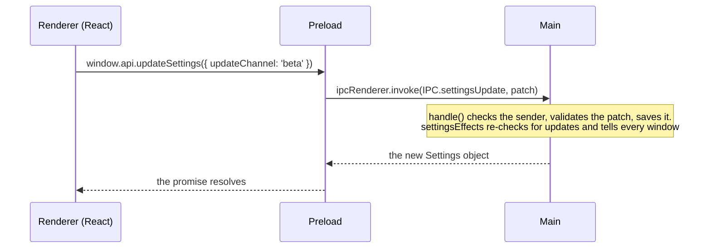
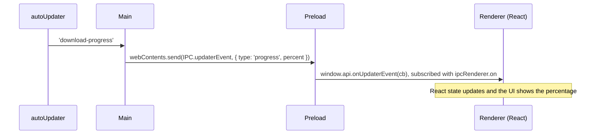

# Architecture

An Electron app runs three kinds of code. Knowing which one you are writing is most of the battle.

Shared types and channel names live in `apps/desktop/src/shared/ipc.ts`, which all three import.

## Folders

| Path                                                            | What lives there                                                                                     |
| --------------------------------------------------------------- | ---------------------------------------------------------------------------------------------------- |
| `apps/desktop/src/main/index.ts`                                | App startup, the window (custom title bar, no white flash), single-instance lock                     |
| `apps/desktop/src/main/updater.ts`                              | `electron-updater`: stable vs beta channel, differential downloads, update events                    |
| `apps/desktop/src/main/deeplink.ts`                             | `myapp://` links and file associations, on macOS, Windows and Linux                                  |
| `apps/desktop/src/main/menu.ts`                                 | The application menu (File, Edit, View, Window, Help) and its keyboard accelerators                  |
| `apps/desktop/src/main/tray.ts`                                 | System tray icon and menu, plus the optional "keep running when closed" setting                      |
| `apps/desktop/src/main/shortcuts.ts`                            | The global show/hide shortcut                                                                        |
| `apps/desktop/src/main/windowUtils.ts`                          | `showWindow`, `toggleWindow` and `requestUpdateCheck`, shared by menu, tray, shortcut and deep links |
| `apps/desktop/src/main/windowState.ts`                          | Remembers window size, position and maximized state between launches                                 |
| `apps/desktop/src/main/settings.ts`                             | Tiny JSON settings file in the user data folder                                                      |
| `apps/desktop/src/main/secureIpc.ts`                            | `handle()`: `ipcMain.handle` that rejects calls not coming from our own page                         |
| `apps/desktop/src/main/trust.ts`                                | `isTrustedUrl()`: which page URLs may talk to main                                                   |
| `apps/desktop/src/main/windowChrome.ts`                         | Shared window options (sandbox, title bar), `hardenWindow`, `loadRenderer`                           |
| `apps/desktop/src/main/ipcHandlers.ts`                          | Handlers for settings, app info, logs and what's new                                                 |
| `apps/desktop/src/main/settingsWindow.ts`, `settingsEffects.ts` | The Settings window, and what changing a setting does                                                |
| `apps/desktop/src/main/logger.ts`                               | `electron-log`: log file, rotation, uncaught errors, "Show Log File"                                 |
| `apps/desktop/src/main/whatsNew.ts`                             | Release notes and first-run state                                                                    |
| `apps/desktop/src/shared/validate.ts`                           | Checks for payloads coming from the renderer                                                         |
| `apps/desktop/src/preload/api.ts`                               | The `window.api` surface. Everything the page can ask main to do is listed here                      |
| `apps/desktop/src/preload/index.ts`                             | Exposes `api` with `contextBridge`                                                                   |
| `apps/desktop/src/shared/ipc.ts`                                | Channel names and payload types                                                                      |
| `apps/desktop/src/renderer/`                                    | The React app, Tailwind and shadcn/ui                                                                |
| `apps/desktop/build/`                                           | App icons (generated) and macOS entitlements                                                         |
| `apps/desktop/scripts/`                                         | Rename, icon generation and bundle-size scripts                                                      |

## How IPC flows

There are two directions, and both go through the preload script.

**Renderer asks, main answers** (request/response):

**Main pushes, renderer listens** (events):

Deep links and opened files use the same push pattern. If a link arrives before the window has
finished loading, `deeplink.ts` queues it and delivers it on `did-finish-load`.

## Adding a new IPC call

1. Add the channel name (and any payload type) to `apps/desktop/src/shared/ipc.ts`.
2. Handle it in main with `handle(IPC.yourChannel, ...)` from `secureIpc.ts` (not `ipcMain.handle`), and
   validate every argument with a function in `apps/desktop/src/shared/validate.ts`. Treat the renderer as untrusted.
3. Expose a typed function in `apps/desktop/src/preload/api.ts`.
4. Call `window.api.yourFunction()` from the renderer. The types flow through automatically.

Keep the preload surface small and specific. Expose "do this one thing" functions, never raw
`ipcRenderer` or file-system access.
