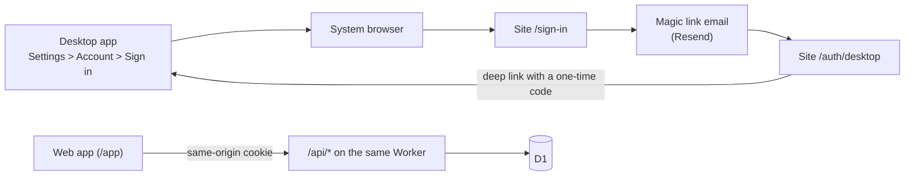

# Monorepo, web app and API

**Decision:** one pnpm + Turborepo monorepo with a desktop app, a web app (marketing/download site plus the product at
`/app`), a small API, and shared packages. Web and API run as one Cloudflare Worker (static assets plus the API, one origin). Desktop and web release
independently.

## Layout

| Folder            | What it holds                                                                                                        |
| ----------------- | -------------------------------------------------------------------------------------------------------------------- |
| `apps/desktop`    | Electron app (electron-vite + electron-builder). Released with the existing release system.                          |
| `apps/web`        | Vite + React SPA: marketing/download site, sign-in and the app at /app.                                              |
| `apps/api`        | Hono API on Cloudflare Workers: D1 database, magic-link sign-in (see [the API guide](../api/overview.md)).           |
| `scripts/`        | `setup-cloud.mjs`: one-command Cloudflare + Resend + GitHub setup (see [the setup guide](../guides/setup-cloud.md)). |
| `packages/ui`     | `@repo/ui`: shared components and the Tailwind theme.                                                                |
| `packages/shared` | zod schemas shared by web, desktop and API.                                                                          |

## Rules that keep it robust

- **One version per dependency.** Shared versions are in the `catalog:` of `pnpm-workspace.yaml`.
- **Packages are source-only and bundled by the app that uses them.** In `apps/desktop` a workspace package is a
  **devDependency**: Vite inlines it, and electron-builder packages only third-party `dependencies`. This avoids
  `node-linker=hoisted`, which breaks pnpm's strictness and electron-builder in subtle ways.
- **Boundaries.** Renderer/web code never imports `electron` or `node:*`. Anything OS-specific goes through `window.api`;
  the web build provides another implementation of the same `Api` type.
- **Independent releases.** Desktop publishes only when desktop code or shared packages change (path filters in
  `publish-*.yml`). Web and API deploy on their own from `main`.
- **Turborepo runs the graph** (`pnpm build`, `pnpm typecheck`, `pnpm test`). Lint, Prettier and commit hooks run once at the root.
- **Line endings are LF** (`.gitattributes`), so Windows and CI agree.

## Delivery plan

1. Workspace + Turborepo, desktop moved to `apps/desktop` (done).
2. Shared UI package `packages/ui` (done). `packages/shared` arrives with the API, when there is real shared code.
3. `apps/web`: marketing/download site and `/app` (done).
4. `apps/api`: Hono, D1 + Drizzle, Better Auth magic links (done).
5. Sign-in on the web (`/sign-in`, `/app`) and in the desktop app (system browser, back through the deep link) (done).
6. Deploy: `pnpm setup:cloud` for the first time, `.github/workflows/deploy-web.yml` afterwards (done; see [the setup guide](../guides/setup-cloud.md)).

## How the three parts connect

The desktop app is built with the API address (`API_URL`); without it the Account section is hidden and the app works
as before, with no account. Releases are independent: desktop releases come from the publish workflows, the site and API
deploy from `main` through `deploy-web.yml`.
